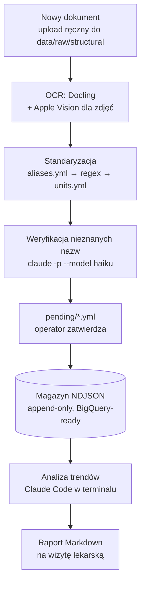
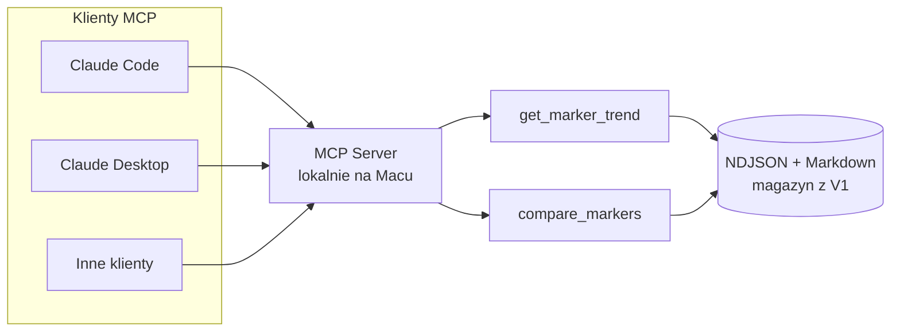
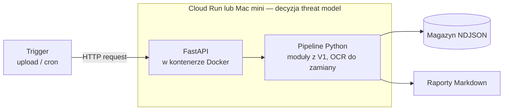
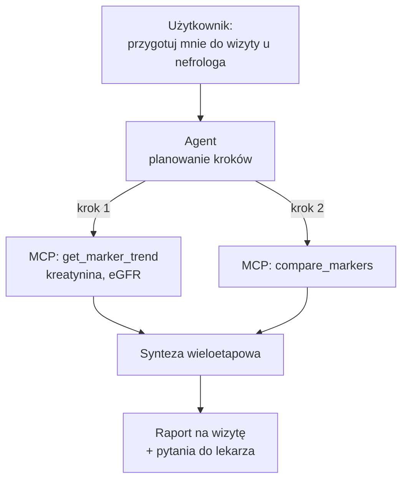
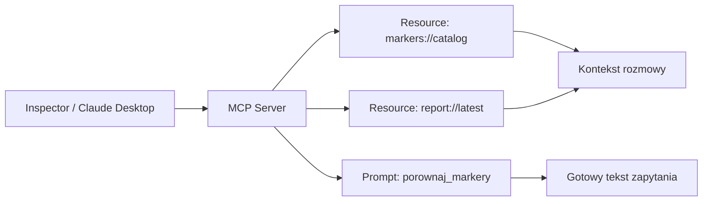
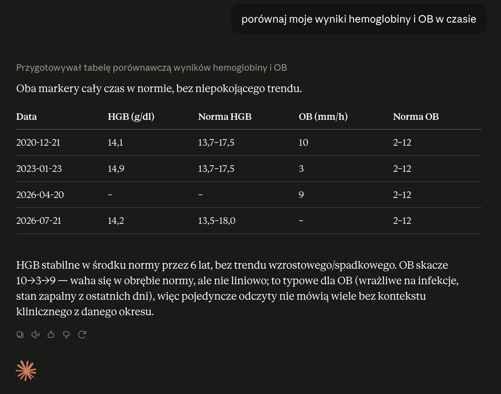

# document-intelligence-platform

Lokalna platforma do przetwarzania osobistej dokumentacji medycznej z analizą trendów w czasie. Projekt służy równolegle jako ścieżka nauki stacku AI Engineering.

## Architektura — mapa wersji

| Wersja | Co robi | Status |
|---|---|---|
| V1 | OCR → standaryzacja → magazyn NDJSON → raporty Markdown | zamknięta |
| V2 | Serwer MCP (Tools) nad tym samym magazynem | zamknięta |
| V3 | Przeniesienie do chmury | pominięta świadomie (backlog) |
| V4 | Agent (Claude Agent SDK) orkiestrujący narzędzia MCP z V2 | zamknięta |
| V5 | Resources i Prompts MCP nad tym samym serwerem (nadobowiązkowa) | zamknięta |

### V1 — fundament: OCR → standaryzacja → magazyn → raport



### V2 — serwer MCP nad magazynem z V1



### V3 — przeniesienie do chmury (pominięta, backlog)



### V4 — agent nad serwerem MCP z V2



### V5 — Resources i Prompts MCP nad tym samym serwerem



Pełne uzasadnienie decyzji, ryzyka i kompetencje nauki dla każdej wersji: `CLAUDE.md` (status i decyzja o pominięciu V3) oraz `docs/v4/prd.md`, `docs/v5/prd.md`.

## Dokumentacja

- **`docs/v1/`** — Version 1 (OCR → magazyn → raporty), zamknięta — kontrakt `docs/v1/prd.md`, plan `00`–`04`
- **`docs/v2/`** — Version 2 (serwer MCP), zamknięta — kontrakt `docs/v2/prd.md`, plan `00`–`03`
- **`docs/v4/`** — Version 4 (agent nad MCP), zamknięta — kontrakt `docs/v4/prd.md`, plan `01`
- **`docs/v5/`** — Version 5 (Resources/Prompts MCP, nadobowiązkowa), zamknięta — kontrakt `docs/v5/prd.md`, plan `01`
- **`CLAUDE.md`** — konwencje projektu dla sesji Claude Code

## Stack

Python (uv) · Docling · Apple Vision · BigQuery · Claude (abonament Pro)

## Uruchomienie

```bash
uv sync                 # odtworzenie środowiska z uv.lock
uv run python <skrypt>  # uruchomienie kodu w środowisku projektu
```

## Codzienny flow — dodawanie nowych wyników

Dwa gotowe prompty do wklejenia w Claude Code — resztę (pipeline, aliasy, raport) robi już on, nie Ty ręcznie w terminalu. Mechanizm w tle: każdy przebieg pipeline'u tworzy migawkę-kandydata (`data/store/YYYY-MM-DD-structural.ndjson`), nigdy nie nadpisuje zaufanego magazynu (`data/store/structural-backfill.ndjson`) — pełne uzasadnienie: `docs/v1/prd.md` v1.3, `docs/v1/04-backfill.md`.

**1. Wrzuciłeś nowy plik do `data/raw/structural/` — wklej prompt, pod nim dopisz ścieżkę pliku:**
```
Wrzuciłem nowy plik do data/raw/structural/. Uruchom pipeline, obsłuż nieznane
markery jeśli się pojawią (zapytaj mnie o zatwierdzenie każdego), wygeneruj
raport z nowej migawki-kandydata i zaczekaj na moją weryfikację — nie scalaj
z zaufanym magazynem.

Plik:
```
Sam prompt zostaje bez zmian za każdym razem — dopisujesz tylko ścieżkę pod linią „Plik:", bez edycji tekstu nad nią.

Dostaniesz ścieżki: migawka `data/store/<data>-structural.ndjson`, raport `data/reports/<data>-trendy.md`. Sprawdź kolumnę **„Źródło"** przy nowych wynikach względem oryginału.

**2. Dane poprawne — wklej prompt, pod nim dopisz ścieżkę migawki z kroku 1:**
```
Zweryfikowałem migawkę wskazaną poniżej — dane poprawne. Scal ją z zaufanym
magazynem data/store/structural-backfill.ndjson.

Migawka:
```

Dopiero teraz dane liczą się „na serio" — BigQuery i dalsza analiza czytają wyłącznie zaufany magazyn. Procedura odświeżenia tabeli (zawsze replace, nigdy append): `docs/v1/03-storage-analysis.md`.

**Przykład:** wracasz z laboratorium z nowym wynikiem TSH, kopiujesz plik do `data/raw/structural/`, wklejasz prompt 1. Marker już w słowniku → od razu dostajesz migawkę i raport do sprawdzenia. Nowy marker/lab → Claude Code najpierw zapyta o zatwierdzenie proponowanego aliasu, dopiero potem wygeneruje raport. Po sprawdzeniu kolumny „Źródło" wklejasz prompt 2.

Dokument z nieczytelnym OCR (za mało wyciągniętego tekstu) nie wejdzie do wyników w ogóle — Claude Code to zgłosi w podsumowaniu; sprawdź skan ręcznie (kąt, ostrość, czy to na pewno badanie krwi/moczu).

## MCP server (V2) — przykład działania

Version 2 udostępnia te same dane przez protokół MCP — Claude Desktop (i inni świadomie skonfigurowani klienci MCP) mogą pytać o trendy i porównania bez dostępu do plików, tak jak dotąd wyłącznie Claude Code w terminalu.

Realne zapytanie w Claude Desktop — `compare_markers` wywołane bez żadnego ręcznego kroku pośredniego, dane z zaufanego magazynu:



Narzędzie zwraca dwie w pełni niezależne serie (bez łączenia po dacie — różne markery bywają badane różnego dnia); to model po stronie odpowiedzi złożył je w jedną czytelną tabelę.

## Pitch — projekt w 30 sekund

> [!IMPORTANT]
> Zbudowałem lokalny pipeline, który zamienia ~390 osobistych dokumentów medycznych — skany, PDF-y, zdjęcia — w kanoniczne dane strukturalne do analizy trendów w czasie. OCR opiera się na Docling z Apple Vision dla zdjęć, bo ten natywnie lepiej czyta polskie diakrytyki i jednostki niż modele ogólne. Cała wiedza domenowa — nazwy markerów, jednostki, zakresy referencyjne — żyje w YAML, nie w kodzie: dodanie nowego laboratorium to edycja configu, nie refaktor. Standaryzacja idzie w trzech warstwach: słownikowe mapowanie nazw, regexowa ekstrakcja wartości, a dla nieznanych nazw weryfikacja przez LLM. Model to wyłącznie Claude na abonamencie Pro (zero zakupu tokenów API), a trafia do niego sama nazwa markera — nigdy pełna treść dokumentu, więc prywatność wynika z architektury, nie z doklejonej warstwy. Człowiek jest w pętli obowiązkowo: propozycje aliasów czekają na zatwierdzenie, a zweryfikowane dane chroni bariera migawka-kandydat plus ręczne scalenie, żeby przyszła poprawka nie zmieniła po cichu już sprawdzonego rekordu. Świadomie odrzuciłem UI, orkiestrator i bazę danych — dla narzędzia jednego użytkownika płaski NDJSON gotowy pod BigQuery w zupełności wystarcza. Najtrudniejsza okazała się nie ścieżka happy-path, tylko integralność danych na skali: pomieszana kolejność OCR, PII wyciekające do pól wyniku — rozwiązane zasadą „nie zgaduj, sygnalizuj" i przeglądem wiarygodności klinicznej, nie kolejnym regexem.
