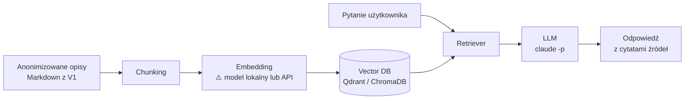
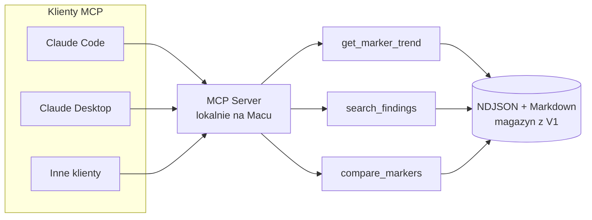
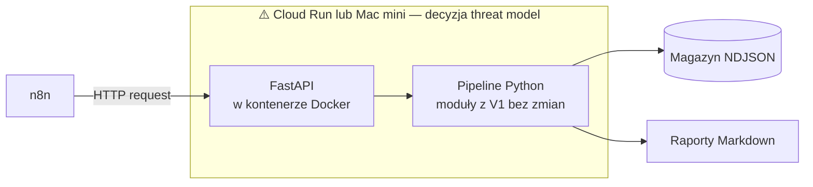

# Roadmap — wersje po V1

> Status: backlog strategiczny, **nie kontrakt**. Kontraktem dla bieżącej pracy jest `docs/prd.md` (Version 1).
> Wracamy tu po ukończeniu V1 (S1–S5 zmierzone w `stages/08-backfill.md`). Każda wersja przed startem przechodzi własną sesję sokratejską i dostaje własny PRD.
> Zastąpił pierwotny zarys `Document-Intelligence-Platform.md` (historia w gicie), który mieszał plan V1 z roadmapą i był sprzeczny z decyzjami PRD.

## Zasada kolejności

Każda wersja kończy się działającym produktem i nie wymaga przepisywania poprzednich modułów. Kolejność V2–V5 poniżej jest wstępna — do rewizji po V1 (patrz uwagi).

---

## Version 2 — RAG nad korpusem narracyjnym

Chunking → embedding → vector database (Qdrant lub ChromaDB) → retriever → LLM.

- **Wartość**: semantyczne wyszukiwanie po opisach badań („czy kiedykolwiek w jakimś badaniu pojawiła się wzmianka o X"). Dane strukturalne tego nie potrzebują — trendy liczbowe obsługuje NDJSON/SQL z V1.
- **Kompetencje**: embedding, semantic search, RAG.
- ⚠️ **Konflikt z ograniczeniem V1 „zero tokenów API"**: embeddingi nie działają na abonamencie Pro. Opcje: lokalny model embeddingowy (sentence-transformers — spójne z lokalnym charakterem projektu) albo rewizja zakazu API. Do rozstrzygnięcia w PRD V2.



## Version 3 — MCP server

Projekt staje się serwerem MCP udostępniającym znormalizowane dane medyczne klientom: Claude Code, Claude Desktop, inne klienty MCP.

- **Wartość**: zamiast „Claude czyta pliki NDJSON z dysku" — narzędzia typu `get_marker_trend`, `search_findings` dostępne z każdego klienta.
- **Kompetencje**: MCP (priorytet nauki właściciela).
- Uwaga: w pierwotnym zarysie MCP było wersją 4, po chmurze. Zamienione kolejnością — lokalny serwer MCP nie wymaga chmury, a kompetencyjnie jest wart więcej i szybciej.



## Version 4 — Przeniesienie do chmury

FastAPI + Docker + Cloud Run; n8n wywołuje endpoint HTTP.

- **Kompetencje**: API development, cloud deployment.
- ⚠️ **Konflikt z threat model**: V1 świadomie przyjęła miękką prywatność przy przetwarzaniu lokalnym. Surowe dokumenty medyczne w Cloud Run to inna klasa ryzyka — PRD V4 musi zacząć od rewizji threat model (wariant z pierwotnej dyskusji: self-hosting na Mac mini zamiast chmury publicznej).



## Version 5 — Architektura agentowa

Agent potrafiący wyszukiwać dokumenty, analizować historię, wykonywać wieloetapowe zadania, planować kroki.

- **Framework do wyboru w PRD V5**: LangGraph, OpenAI Agents SDK lub Claude Agent SDK (naturalny kandydat przy stacku z V1: agent nad serwerem MCP z V3).
- **Kompetencje**: agentic AI.

```mermaid
flowchart TD
    U[Użytkownik:<br>„przygotuj mnie do wizyty u nefrologa"] --> A[Agent<br>planowanie kroków]
    A -->|krok 1| T1[MCP: search_findings<br>ustalenia nerkowe]
    A -->|krok 2| T2[MCP: get_marker_trend<br>kreatynina, eGFR]
    A -->|krok 3| T3[RAG: opisy USG<br>jamy brzusznej]
    T1 & T2 & T3 --> S[Synteza wieloetapowa]
    S --> O[Raport na wizytę<br>+ pytania do lekarza]
```

---

## Rozszerzenia domenowe (niezależne od wersji)

Świadomie wycięte z V1 (decyzja z sesji sokratejskiej: jedna domena, pełny pipeline). Możliwy powrót po V1, każde jako osobny PRD:

- **Legal** (umowy, NDA, pisma) — uwaga z sesji: to inny pipeline niż medyczny; wspólne tylko OCR + Presidio (~30% reuse). Realistyczny start: ścieżka „anonymize & ask" bez strukturyzacji.
- **Finance** (faktury, raporty), **HR** (CV, umowy), **Technical** (instrukcje, manuale).
