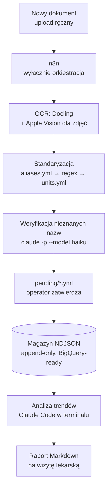
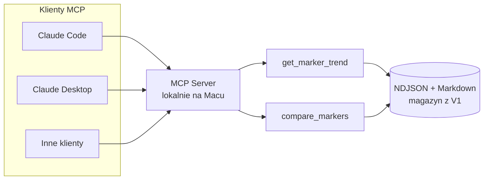
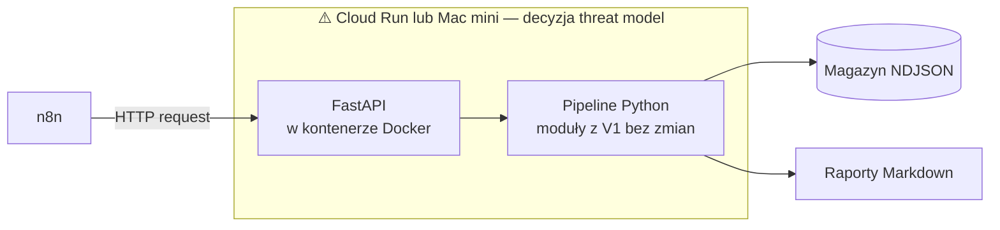
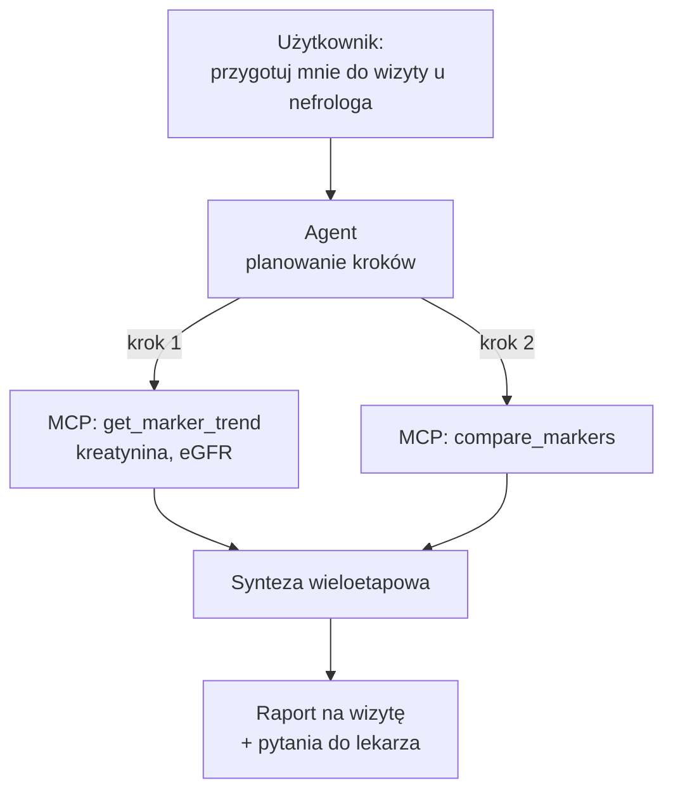

# Roadmap — wersje po V1

> Status: backlog strategiczny, **nie kontrakt**. Kontraktem dla bieżącej pracy jest `docs/prd.md` (Version 1).
> Wracamy tu po ukończeniu V1 (S1–S4 zmierzone w `stages/08-backfill.md`). Każda wersja przed startem przechodzi własną sesję sokratejską i dostaje własny PRD.
> Zastąpił pierwotny zarys `Document-Intelligence-Platform.md` (historia w gicie), który mieszał plan V1 z roadmapą i był sprzeczny z decyzjami PRD.

## Zasada kolejności

Każda wersja kończy się działającym produktem i nie wymaga przepisywania poprzednich modułów. Kolejność V2–V4 poniżej jest wstępna — do rewizji po V1 (patrz uwagi).

---

## Fundament — Version 1 (w realizacji)

Pełny zakres i wymagania: `docs/prd.md`. Diagram poglądowy — wszystkie kolejne wersje budują na tych modułach:

## Version 2 — MCP server

Projekt staje się serwerem MCP udostępniającym znormalizowane dane medyczne klientom: Claude Code, Claude Desktop, inne klienty MCP.

- **Wartość**: zamiast „Claude czyta pliki NDJSON z dysku" — narzędzia typu `get_marker_trend`, `search_findings` dostępne z każdego klienta.
- **Kompetencje**: MCP (priorytet nauki właściciela).

## Version 3 — Przeniesienie do chmury

FastAPI + Docker + Cloud Run; n8n wywołuje endpoint HTTP.

- **Kompetencje**: API development, cloud deployment.
- ⚠️ **Konflikt z threat model**: V1 świadomie przyjęła miękką prywatność przy przetwarzaniu lokalnym. Surowe dokumenty medyczne w Cloud Run to inna klasa ryzyka — PRD V3 musi zacząć od rewizji threat model (wariant z pierwotnej dyskusji: self-hosting na Mac mini zamiast chmury publicznej).

## Version 4 — Architektura agentowa

Agent potrafiący wyszukiwać dokumenty, analizować historię, wykonywać wieloetapowe zadania, planować kroki.

- **Framework do wyboru w PRD V4**: LangGraph, OpenAI Agents SDK lub Claude Agent SDK (naturalny kandydat przy stacku z V1: agent nad serwerem MCP z V2).
- **Kompetencje**: agentic AI.

---

## Rozszerzenia domenowe (niezależne od wersji)

Świadomie wycięte z V1 (decyzja z sesji sokratejskiej: jedna domena, pełny pipeline). Możliwy powrót po V1, każde jako osobny PRD:

- **Legal** (umowy, NDA, pisma) — uwaga z sesji: to inny pipeline niż medyczny; wspólne tylko OCR (~15% reuse). Realistyczny start: ścieżka „anonymize & ask" bez strukturyzacji.
- **Finance** (faktury, raporty), **HR** (CV, umowy), **Technical** (instrukcje, manuale).

---

## Uwaga techniczna dla przyszłych sesji — diagramy Mermaid

Przy edycji lub dodawaniu diagramów w tym repo:

- **Etykiety węzłów zawsze w cudzysłowach**: `A["etykieta"]`, nie `A[etykieta]` — obowiązkowo gdy etykieta zawiera dwukropek, przecinek, `+`, nawiasy lub polskie znaki interpunkcyjne.
- **Żadnych cudzysłowów wewnątrz etykiet** (także polskich `„..."`) — znak `"` w treści etykiety łamie parser GitHuba (incydent: diagram V5, commit `88e5dc2`; objaw: `Unable to render rich display, got 'STR'`). Cytaty parafrazuj bez cudzysłowów.
- Po każdej zmianie diagramu zweryfikuj render na GitHubie, nie tylko lokalnie.
